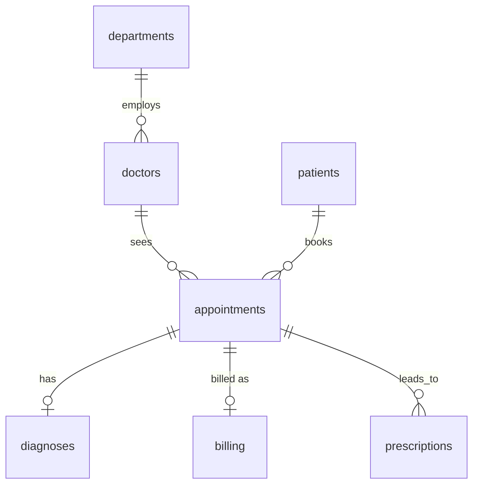

# Hospital Operations & Billing Analysis (SQL)

An end-to-end SQL project on a synthetic hospital database: inspect the data, find and handle quality problems, then answer 12 business questions about patients, appointments and billing.

## Overview

| | |
|---|---|
| **Database** | MySQL (`healthcare_portfolio`), written and tested in MySQL Workbench |
| **Data** | Synthetic data for a single hospital, 2021 to Sep 2026 (7 tables, about 28,700 rows) |
| **Audience** | A hospital operations director |
| **SQL used** | Joins (inner, left, anti-join), aggregation, `CASE`, subqueries, views, CTEs, window functions (`RANK`, `NTILE`, `LAG`, `AVG OVER`) |

## Business problem

An operations director wants to know how the hospital is performing: how busy it is, how many patients attend, how much it bills and collects, and whether anything in the data should not be trusted. The data is deliberately messy, so a large part of the work is finding and documenting the problems before any numbers are reported.

## Dataset

| Table | Rows | Description |
|---|---|---|
| `departments` | 10 | Hospital departments |
| `doctors` | 70 | Doctors, with department and specialisation |
| `patients` | 2,652 | Demographics and insurance provider |
| `appointments` | 9,000 | One row per appointment, with status and date |
| `diagnoses` | 4,689 | At most one per appointment |
| `billing` | 7,857 | At most one bill per appointment |
| `prescriptions` | 4,449 | 0 to 2 per appointment |

`billing` has no `patient_id`, so bills are linked to patients through `appointments`. Full column definitions are in `data_dictionary.md` and the table definitions in `schema.sql`.

## Repository contents

| File | Purpose |
|---|---|
| `schema.sql` | Table definitions |
| `00_load_data.sql` | Loads the CSV files into the tables |
| `01_data_exploration.sql` | Row counts, date ranges, categories, table relationships |
| `02_data_cleaning.sql` | Data-quality investigation, plus the cleaned views used in every later file |
| `03_patient_analysis.sql` | Q3, Q4, Q5, Q12 |
| `04_operations_and_revenue.sql` | Q1, Q2, Q6, Q7, Q8 |
| `05_advanced_analysis.sql` | Q9, Q10, Q11 |
| `csv/` | The source data |

**To reproduce:**
1. Create the database: `CREATE DATABASE healthcare_portfolio;`
2. Run `schema.sql` to create the tables.
3. Edit the file path in `00_load_data.sql` to point at the `csv/` folder, then run it. It ends with a row-count check (expected: 10, 70, 2,652, 9,000, 4,689, 7,857, 4,449). If your MySQL blocks `LOAD DATA LOCAL INFILE`, the script's header explains the alternative (the Table Data Import Wizard).
4. Run `01_data_exploration.sql` to `05_advanced_analysis.sql` in order.

The CSV files use Windows line endings (`\r\n`) and the `£` symbol in `billing.amount` requires UTF-8; the load script already handles both.

## Data cleaning approach

The raw tables are **never modified** (no `UPDATE`, `DELETE` or `ALTER`). Every fix is applied in views (`v_patients_clean`, `v_appointments_clean`, `v_billing_clean`, `v_diagnoses_clean`, `v_prescriptions_clean`), so the original data stays intact and each decision is visible in the SQL. All results use a fixed reference date of **2026-09-16** (the latest date in the data) instead of `CURDATE()`, so the results do not change depending on when the script is run.

| Problem found | Evidence | Decision |
|---|---|---|
| `billing.amount` stored as text; 301 values carry a `£` | `SUM()` on the text column gives £3,175,176.89, but the true total is £3,309,003.64 (understated by £133,826.75) | Strip `£` and `CAST` to `DECIMAL(10,2)` |
| Inconsistent categories | Gender (`M`, `Male`, blank...), insurance provider, appointment status (`No-show` vs `No Show`) | Standardised with `CASE`; `No-show` and `No Show` merged into `MISSED` |
| Future dates | 6 patient birth dates, 8 appointment dates (2030), 6 bill dates (2030) | Set to `NULL` (unknown) rather than guessed |
| Orphaned foreign keys | 9 appointments reference a non-existent patient; 11 reference a non-existent doctor | Excluded by `JOIN` where the patient or doctor is needed; kept in appointment-only counts |
| Malformed diagnosis codes | 8 rows (7 distinct codes) in lowercase with no decimal point (e.g. `e785`) | Mapped to the correct code (e.g. `E78.5`) |
| Probable duplicate patients | 50 extra rows share name and date of birth with another patient | Reported, not removed (same name and birth date is strong evidence, not proof) |
| Negative billing amounts | 236 bills, totalling -£89,108.55 | Kept and flagged; see Limitations |

## Business questions and key findings

Each finding separates what the data **shows** (observation) from what it **might mean** (interpretation).

### Basic

**Q1. What is the total amount billed?** (`04`)
- *Observation:* £3,309,003.64 in total. Positive amounts alone total £3,398,112.19 and the negative amounts total -£89,108.55.
- *Implication:* Reporting the raw text sum would understate billing by about £134k.

**Q2. What share of appointments are completed, missed, cancelled or scheduled?** (`04`)
- *Observation:* Completed 55.3%, scheduled 22.6%, cancelled 11.9%, missed 10.2%.
- *Data check:* 2,027 appointments are still marked "Scheduled" although their date has passed (some by years). In addition, 95.5% of missed appointments have a bill, and so do 94.9% of "scheduled" ones.
- *Interpretation:* The status column is probably not being updated after the appointment date, so "Scheduled" in this data cannot be read as "upcoming". Why missed appointments are billed cannot be determined from the data (it might be a fee, or a recording error).

**Q3. How many patients have an insurance provider on file?** (`03`)
- *Observation:* 1,659 (62.6%) have a provider (BUPA, AXA Health, Vitality or NHS); 993 (37.4%) do not (self-pay, "None" or blank).

### Intermediate

**Q4. Which diagnoses are most common in each age band?** (`03`)
- *Observation:* The most common diagnosis differs by band (e.g. low back pain in 0-25 and 51-75, atherosclerotic heart disease in 76-100), but counts are close together. In the 26-50 band two diagnoses tie at 102.
- *Interpretation:* There is no strong link between age and diagnosis in this data. For example, there are 79 cases of atherosclerotic heart disease and 88 of breast cancer in the 0-25 band, which is clinically unrealistic and consistent with synthetic data. The top-ranked diagnoses should not be treated as meaningful differences.

**Q5. Which medications are prescribed most in each age band?** (`03`)
- *Observation:* Top medication per band: sertraline (0-25), ibuprofen (26-50), amoxicillin (51-75), cetirizine and sumatriptan tied (76-100). Counts within each band are close.
- *Interpretation:* As with Q4, the differences are small and should not be over-read.

**Q6. How are workload and attendance spread across departments?** (`04`)
- *Observation:* Psychiatry is the busiest (1,429 appointments, 57.1% completed). Cardiology has the highest missed rate (12.9% vs 10.2% overall).
- *Interpretation:* Cardiology's missed rate is worth a closer look. It cannot be explained from this data.

**Q7. How does billed revenue change by quarter?** (`04`)
- *Observation:* Billing is roughly flat at £130k to £165k per quarter from 2021 to 2026. The 2026 Q3 figure (£132.7k) is a partial quarter that ends on 16 Sep.
- *Interpretation:* No clear growth or decline trend.

**Q8. How much is the hospital still waiting to be paid?** (`04`)
- *Observation:* 3,509 bills are Unpaid or Pending. They total £1,479,630.34 including negative amounts, or £1,517,400.76 counting positive amounts only. The 10 patients who owe the most each owe about £2,400 to £2,900.
- *Assumption:* "Pending" is treated as money still owed. If pending payments are not yet due, the true overdue figure is lower.

### Advanced

**Q9. How concentrated is billed revenue?** (`05`)
- *Observation:* The top 10% of patients (251 patients) account for 21.9% of billed revenue; the bottom 10% account for 1.8%.
- *Interpretation:* Revenue is skewed but not extremely concentrated. The data cannot say whether high spenders are sicker or simply visit more often.

**Q10. How often do patients return within 30 days of a completed visit?** (`05`)
- *Observation:* Of 2,710 repeat visits, 130 (4.8%) came within 30 days of the previous completed visit; the average gap is about 514 days.
- *Interpretation:* Quick returns are uncommon. The data cannot show whether a return was a planned follow-up or a readmission.

**Q11. Which doctors handle more or fewer appointments than their department average?** (`05`)
- *Observation:* Doctors range from 26 fewer to 21 more appointments than their department average (e.g. +20.9 for Kirsty Hawkins in General Surgery, -26.3 for Jessica White in Radiology).
- *Limitation:* Appointment counts are not adjusted for how long each doctor has worked there, so a low count may only reflect a later hire date.

**Q12. How do insurance segments compare on attendance and billing?** (`03`)
- *Observation:* Missed-appointment rates range from 8.8% to 10.8% and average bills from £439 to £460 across the seven segments.
- *Interpretation:* The differences are small, and several segments have few patients (NHS: 171), so these gaps may be chance. The data does not support any claim that insurance type affects attendance or bill size.

## Limitations

- **Negative billing amounts are unexplained.** Only 25 of the 236 negative bills are marked "Refunded"; 107 are "Paid" and 104 are "Unpaid" or "Pending". The data does not show whether they are refunds, credit notes or sign errors. Totals are therefore shown both with and without them.
- **Appointment status is unreliable** (see Q2): thousands of "Scheduled" appointments are in the past, and missed appointments are billed.
- **Duplicate patients** (about 50) were reported but not merged, so patient counts may be slightly overstated.
- **Excluded rows:** 20 appointments (9 with an unknown patient, 11 with an unknown doctor) drop out of any analysis that needs that link, and 7 bills cannot be linked to a patient.
- **`insurance_provider` and `insurance_covered`** describe different events (registration vs a specific bill), so they cannot be cross-checked for errors.
- **Synthetic data.** Several results (Q4, Q5, Q7, Q12) show almost no variation, which is typical of randomly generated data. Findings should not be read as real-world clinical or financial conclusions.
- **Correlation, not causation.** No query here identifies why anything happens.

## Future improvements

- Merge duplicate patients with a more careful matching rule (name, date of birth and phone/email).
- Follow up the negative amounts with the data owner.
- Adjust doctor workload for time in post (using `hire_date`).
- Add a dashboard (Tableau or Power BI) on top of the cleaned views.
- Repeat the analysis in a second dialect (PostgreSQL) to show portability.
